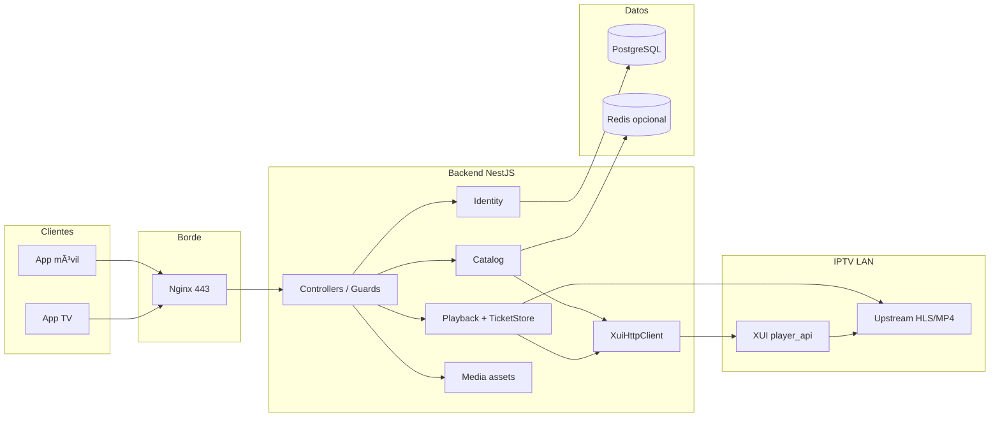

# Arquitectura observada — Backend COTAS

- **Fecha:** 2026-11-11 (America/Lima, UTC-5)
- **Commit auditado:** `8fa5549a7cd15e4204edfbd944a5328596c12d84`
- **Base API verificada:** `https://api.cotasperu.com/api/v1`
- **Método:** inspección de repositorio + health checks públicos + pruebas funcionales controladas
- **Restricción:** solo lectura; sin cambios al sistema

---

## 1. Descripción de arquitectura real

El backend es una API **NestJS 12** (Node ≥24) que:

1. Autentica clientes IPTV (usuario/clave de línea XUI o login QR TV↔móvil).
2. Persiste identidad, sesiones, dispositivos, MFA, recordatorios y auditoría en **PostgreSQL** vía **Prisma 6**.
3. Consulta catálogo y autoriza reproducción contra **XUI** (`player_api.php`) en red interna.
4. Expone URLs de media bajo el **mismo origen** de la API (`/playback/media/{ticket}`), actuando como **proxy** hacia el upstream de streaming.
5. Opcionalmente usa **Redis** para caché de catálogo y **FCM** para push.

Límites de confianza:

| Zona | Componentes | Confianza |
| --- | --- | --- |
| Pública Internet | `api.cotasperu.com` (Nginx → host:3100 → contenedor:3000) | No confiable |
| LAN COTAS | Backend, PostgreSQL, XUI `<XUI_INTERNAL_HOST>`, Astra/stream | Semi-confiable / privada |
| Cliente app | Flutter / Tizen / TV | No confiable |

---

## 2. Diagrama de componentes

---

## 3. Módulos NestJS y responsabilidades

| Módulo / área | Responsabilidad | Ubicación principal |
| --- | --- | --- |
| Identity | Login, refresh, logout, MFA, admin users, devices, device-link QR, subscription, reminders, push-token | `src/modules/identity/` |
| Catalog | Home, live/VOD/series, EPG, announcements, sync XUI | `src/modules/catalog/` |
| Playback | Autorización + proxy media por ticket | `src/modules/playback/` |
| Media | Assets firmados (posters) | `src/modules/media/` |
| Integrations/XUI | Cliente HTTP + mappers | `src/modules/integrations/xui/` |
| Notifications | FCM | `src/modules/notifications/` |
| Audit | Listado de eventos (roles staff) | `src/modules/audit/` |
| Health | live / ready / dependencies | `src/modules/health/` |
| Common | DomainError, rate-limit sensible, redact, helmet/CORS | `src/common/`, `src/configure-http.ts` |
| Worker | Entrypoint secundario (`worker.main.ts`) | sync/colas según config |

Guards globales: `ThrottlerGuard`, `AccessTokenGuard`, `RolesGuard` (`app.module.ts`).

---

## 4. Inventario de endpoints HTTP

Prefijo real: `/api/v1` (confirmado en docs y tráfico a producción de pruebas).

### Públicos (`@Public`)

| Método | Ruta | Notas |
| --- | --- | --- |
| GET | `/health/live` | 200 OK verificado |
| GET | `/health/ready` | 200 OK verificado |
| POST | `/auth/login` | |
| POST | `/auth/refresh` | |
| POST | `/auth/mfa/setup` | enrollment |
| POST | `/auth/mfa/confirm` | |
| POST | `/auth/device-link/session` | TV crea QR |
| GET | `/auth/device-link/session/:code` | TV poll |
| GET | `/media/asset` | URL firmada |
| GET | `/playback/media/:ticketId` | proxy playlist (sin JWT) |
| GET | `/playback/media/:ticketId/seg` | proxy segmento |

### Autenticados (Bearer)

| Método | Ruta |
| --- | --- |
| POST | `/auth/logout` |
| GET | `/auth/me` |
| GET | `/auth/session` |
| POST | `/auth/device-link/approve` |
| GET/DELETE | `/sessions`, `/sessions/:id` |
| GET/POST/DELETE/PUT | `/devices`, `/devices/heartbeat`, `/devices/push-token`, `/devices/:id` |
| GET | `/account/subscription` |
| CRUD | `/account/reminders` |
| GET… | `/catalog/*` (home, live, vod, series, epg, announcements) |
| POST | `/playback/authorizations` |

### Staff

| Método | Ruta | Rol |
| --- | --- | --- |
| GET | `/health/dependencies` | OPERATOR+ (401 sin auth verificado) |
| GET/POST/PATCH | `/admin/users`… | Admin |
| GET | `/audit/events` | Audit |

---

## 5. Flujo de autenticación

1. `POST /auth/login` valida línea en XUI, `acceptLine` en PG, `claimDeviceSlot` (cupo), emite access JWT (HS256) + refresh opaco hasheado.
2. `AccessTokenGuard` verifica JWT + sesión no revocada en PG.
3. `POST /auth/refresh` rota refresh; invalida access previo ligado a sesión.
4. `POST /auth/logout` / `DELETE /devices/:id` revocan sesión y liberan cupo de dispositivo; push `device_session_closed` si FCM.
5. QR: TV `device-link/session` → móvil `approve` → TV poll canjea tokens propios.

---

## 6. Flujo de catálogo

Cliente Bearer → `CatalogUseCase` → credenciales de línea desde PG → `XuiHttpClient` → presentación + URLs de media firmadas (`/media/asset`). Caché opcional Redis. `GET /catalog/home` agregado verificado (200, ~26 KB).

---

## 7. Flujo de autorización y reproducción

1. `POST /playback/authorizations` (Bearer + rate-limit sensible) resuelve stream en XUI y crea ticket en `PlaybackMediaTicketStore` (Map en memoria).
2. Respuesta `delivery` + `streamUrl` bajo `/playback/media/{ticket}` (sin credenciales XUI en cuerpo; verificado).
3. Player abre ticket **sin JWT**; backend hace proxy al upstream y reescribe playlists HLS.

---

## 8. Integración XUI

- Cliente: `src/modules/integrations/xui/infrastructure/http/xui-http.client.ts`
- Host permitido configurable (`allowedStreamHosts`).
- Credenciales de línea cifradas en PG; no se devuelven al cliente en login/authorize (verificado en respuestas 200).
- LAN `<XUI_INTERNAL_HOST>` no alcanzable desde la estación del auditor (timeout); el backend en servidor sí la usa (subscription `source=live`).

---

## 9. Dependencias internas / externas

**Internas:** Prisma/PG, Redis opcional, FCM opcional, worker.

**Externas:** XUI/Astra streaming, Firebase FCM, GitHub Actions CI/CD (fuera de runtime).

---

## 10. Componentes no verificables en esta auditoría

| Componente | Motivo |
| --- | --- |
| Nginx / Docker en host `10.10.0.31` | Sin acceso SSH autorizado en la sesión |
| Panel XUI / límites UI “Never Expire” | Solo lectura vía API COTAS; no se abrió panel |
| Carga ≥50 VU / estrés | Sin autorización explícita de estrés; riesgo a entorno compartido |
| Fallos inducidos PG/XUI | Prohibido en entorno compartido |
| Multi-réplica backend | Ticket store in-memory: comportamiento multi-instancia no medido en lab |

---

## 11. Health

| Endpoint | Resultado 2026-11-11 |
| --- | --- |
| `GET /health/live` | 200 `{"status":"ok"}` |
| `GET /health/ready` | 200 |
| `GET /health/dependencies` sin auth | 401 |
| `http://10.10.0.31:3100/...` desde estación auditor | no alcanzable (código 000) |

---

## 12. Observaciones de configuración / contrato (post-inventario)

| Tema | Evidencia | Implicación |
| --- | --- | --- |
| CORS methods | `configure-http.ts` solo GET/POST/DELETE/OPTIONS | PUT/PATCH de devices/reminders/admin pueden fallar en browser (CODE-012) |
| OpenAPI | `openapi/openapi.json` desfasado vs controllers | contratos incompletos para integradores (CODE-013) |
| MFA enrollment | `signEnrollmentToken` sin callers productivos | setup MFA no conectado al login (CODE-008) |
| README vs código | docs antiguas niegan proxy de vídeo | el código **sí** proxifica `/playback/media/*` |
