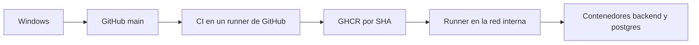

# Integración y despliegue continuos

El desarrollo sigue en Windows. GitHub prueba el cambio, publica una imagen inmutable y el servidor interno la descarga. No hace falta copiar el árbol a mano en cada versión.

## Workflows

| Archivo | Cuándo corre | Dónde corre | Qué hace |
| --- | --- | --- | --- |
| `.github/workflows/ci.yml` | Pull request a `main`, push a `main`, ejecución manual | Runner hospedado por GitHub | Formato, lint, secretos, auditoría crítica, unitarias, e2e, integración con PostgreSQL y compilación |
| `.github/workflows/publish.yml` | Solo si el CI de un push a `main` termina bien | Runner hospedado por GitHub | Construye `backend/Dockerfile` y publica el SHA. Comprueba que el usuario sea `cotas` y que la salud responda |
| `.github/workflows/deploy.yml` | Si la publicación termina bien, o a mano | Runner con etiqueta `cotas-pruebas` | Copia previa, imagen fijada, migraciones en un despliegue normal, salud |

Un pull request ejecuta solo el CI. No publica ni despliega.

La publicación no usa la etiqueta `latest`. La referencia de despliegue es `ghcr.io/<propietario-en-minúsculas>/backend-cotas:<sha de 40 caracteres>`.

## Alternativas de red

El servidor de pruebas no es accesible desde Internet. GitHub no puede abrir una sesión hacia él.

| Alternativa | Seguridad | Mantenimiento | Recursos |
| --- | --- | --- | --- |
| A. Runner en el mismo servidor de pruebas | El runner y la API comparten máquina. Quien controle un workflow de `main` puede usar Docker. No abre puertos nuevos | Un solo equipo que actualizar | Cabe en los 4 vCPU y 7.8 GiB ya descritos, con poco disco libre |
| B. Runner en otra VM interna y SSH hacia el servidor | Separa la ejecución del workflow de los datos. SSH solo en la red interna | Hay que cuidar dos máquinas y una clave | Exige una VM que no está en el inventario actual |

Se elige la alternativa A. No hay otra máquina interna descrita, y abrir SSH a Internet queda descartado. La alternativa B es preferible si más adelante existe esa VM: el workflow no tendría que cambiar de idea, solo el lugar del runner y un salto SSH interno. Hoy el despliegue no usa SSH.

Límites de la alternativa A:

- El runner se registra solo en este repositorio.
- El job de despliegue no escucha pull requests ni código de forks.
- El entorno de GitHub `pruebas` debe exigir un revisor antes de la primera ejecución real.
- El usuario Linux del runner no es el de operación general. Pertenece al grupo `docker`, y eso equivale a root en el host. Por eso el workflow no acepta comandos libres: solo `deploy` o `rollback` y un SHA validado.

## Lo que esta guía no afirma

El runner no se instaló en el servidor durante esta implementación. Hasta completar `runner-autohospedado.md` y `instalacion-ubuntu.md`, el job de despliegue queda en espera o falla por falta de entorno. La reversión sobre ese servidor tampoco se ejecutó.
